<div align="center">


# Contô

**Personal finance app for Android, built with MIT App Inventor.**

[](https://github.com/Ruanleal/conto/actions/workflows/ci.yml)
[](https://github.com/Ruanleal/conto/releases/latest)
[](LICENSE)
[](#installation)
[](https://appinventor.mit.edu)

[Português](README.md) · **English**


</div>

## Contents

- [About](#about)
- [Features](#features)
- [Screenshots](#screenshots)
- [Installation](#installation)
- [Bank notification reader](#bank-notification-reader)
- [Updating without losing data](#updating-without-losing-data)
- [Architecture](#architecture)
- [Quality and testing](#quality-and-testing)
- [Repository structure](#repository-structure)
- [Known limitations](#known-limitations)
- [License](#license)

## About

Contô is a personal finance app for keeping track of where your money goes without complicated spreadsheets. You record income and expenses in a few taps, follow the month's spending by category and see how things change over time. Since version 2.0, the app also reads notifications from banking apps and suggests entries for you to review.

Everything stays on the phone: there is no account, no login and no data sent to the internet.

The app's interface is in Brazilian Portuguese.

## Features

| | |
|---|---|
| **Entries** | Income and expenses in reais (comma decimals), category and payment method with icons, date (including past days) and an option to repeat every month. |
| **History** | Month, year or the whole period; search that ignores case and accents; edit and delete, always with a confirmation. |
| **Chart** | Spending by category as a donut chart, with the period total, income, balance and each category's limit. |
| **Limits** | A monthly limit per category, with a warning when an expense gets close to or goes over it. |
| **Progress** | Income and expenses month by month, a summary of the selected month and a savings goal with a forecast of when it will be reached. |
| **Bank notifications** | Reads notifications from banking apps and suggests entries. You can also paste the bank's message or SMS. |
| **Statement import** | Reads bank statements in CSV, in several date and amount formats, suggests the category and skips what is already there. |
| **Your data** | Spreadsheet export, backup and restore, with a backup reminder. |
| **Profile and theme** | Name and photo (camera or gallery) and a light or dark theme. |

## Screenshots

| Entries | History | Chart | Progress |
|:---:|:---:|:---:|:---:|
| 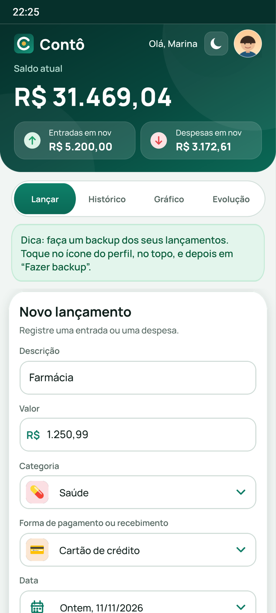 | 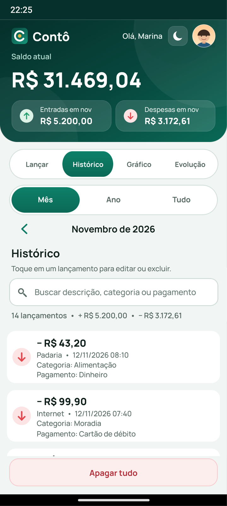 | 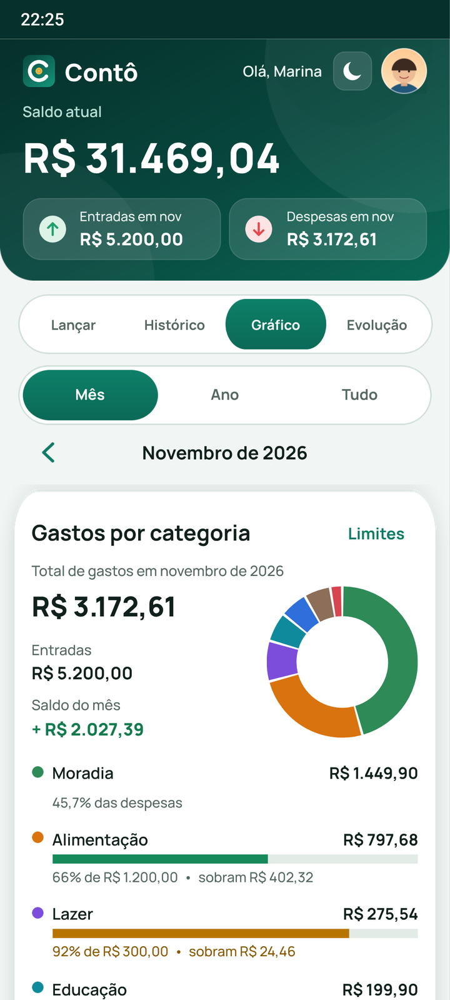 | 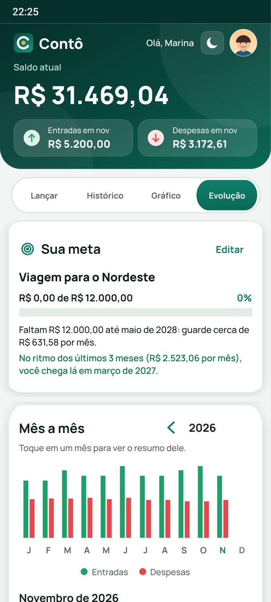 |

| Bank notifications | Pasted message | Limits | Profile |
|:---:|:---:|:---:|:---:|
| 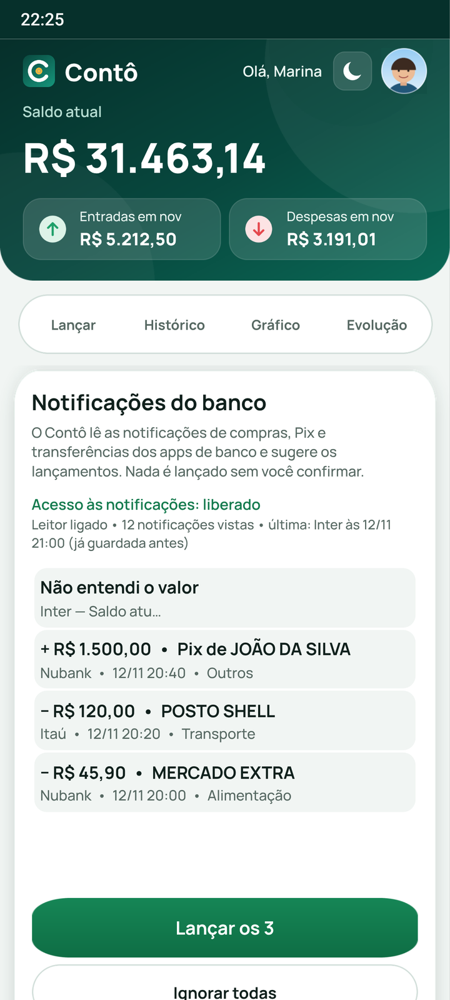 | 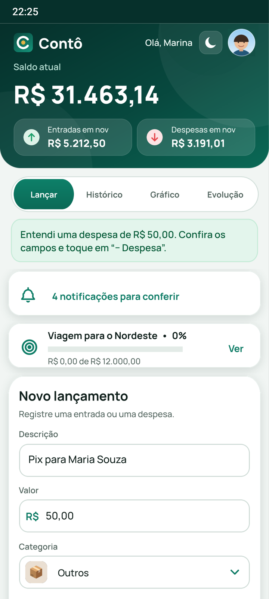 | 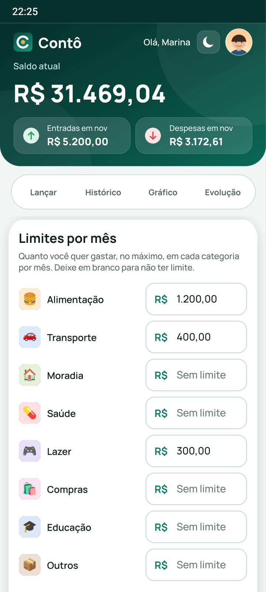 | 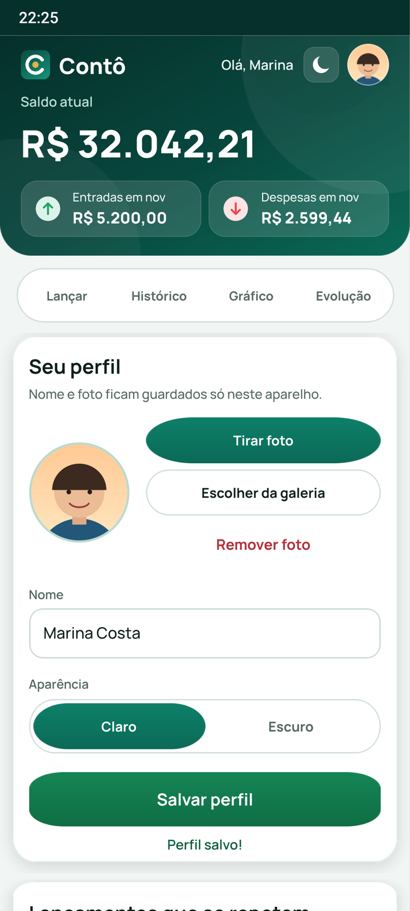 |

<details>
<summary><b>Dark theme</b></summary>
<br>

| Entries | History | Chart | Bank notifications |
|:---:|:---:|:---:|:---:|
| 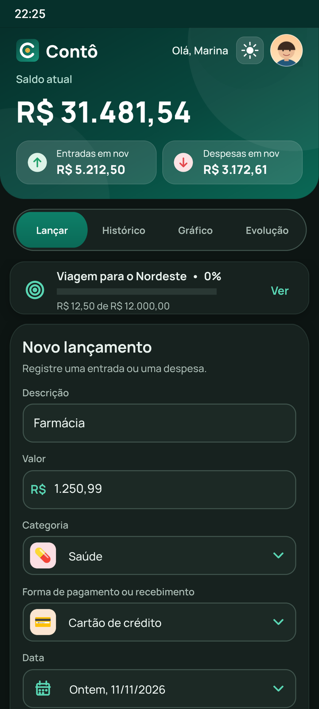 | 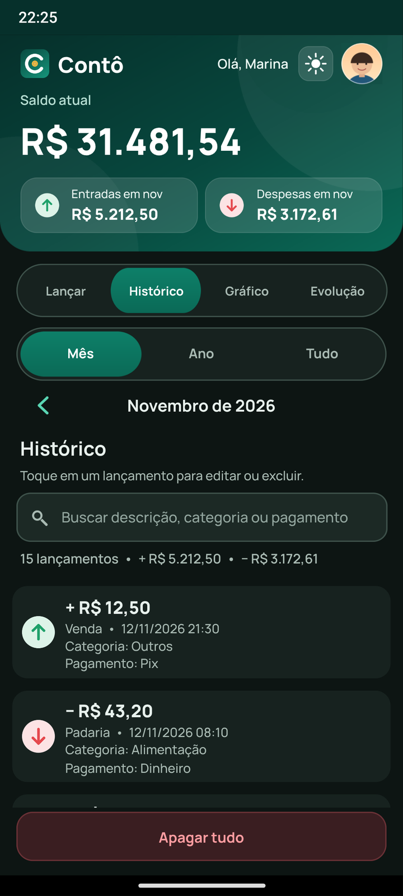 | 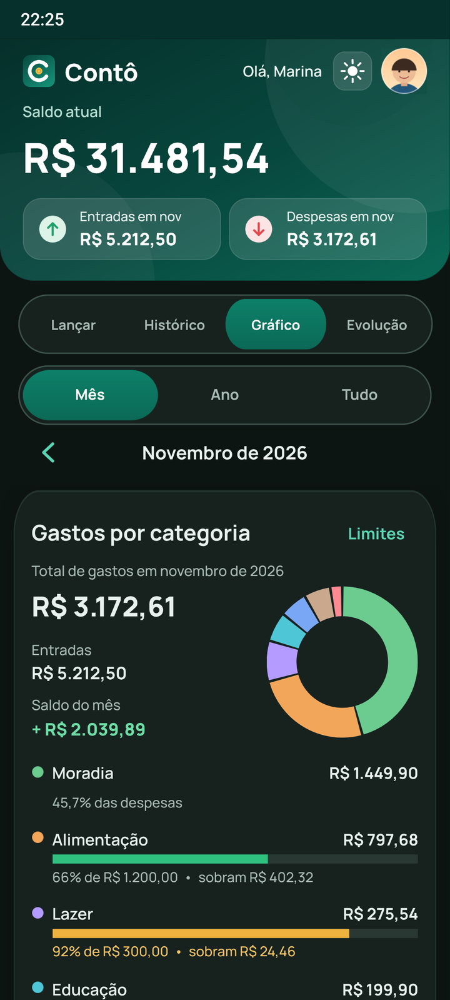 | 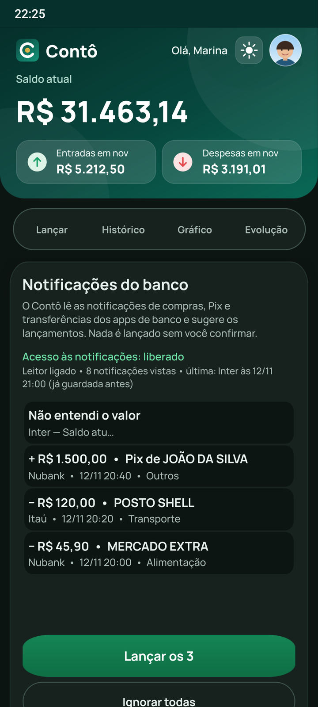 |

</details>

The screens were rendered by the project's simulator from the `.aia`, with sample data.

## Installation

You need a free [MIT App Inventor](https://ai2.appinventor.mit.edu) account and an Android phone.

1. Download `Conto.aia` from the [latest release](https://github.com/Ruanleal/conto/releases/latest) (or from the [`app/`](app/) folder).
2. In App Inventor, open **Projects → Import project (.aia) from my computer** and choose the file. The notification extension is already inside the project.
3. Use **Build → Android App (.apk)** and install the APK on the phone.

> [!IMPORTANT]
> Install the APK. The AI Companion does not include the service that receives notifications, so the reader only works in the installed app.

## Bank notification reader

App Inventor has no block for reading other apps' notifications, so Contô ships its own extension, [`com.conto.notificacoes`](extension/):

- an Android service stores notifications from banking apps, even with Contô closed;
- the app interprets each one (income or expense, amount and description) and shows a list to review: nothing is recorded without your confirmation;
- by default it only stores notifications with an amount in R$ and ignores messaging, e-mail and social media apps;
- notifications stay on the phone.

**Granting access.** In the app, open **Perfil → Seus dados → Notificações do banco** (Profile → Your data → Bank notifications) and tap **Liberar acesso** (Grant access). On Android 13 or newer, an app installed from an APK may show **"Restricted setting"**. In that case:

1. Open **Settings → Apps → Contô**.
2. Tap the **⋮** menu and **Allow restricted settings**. The option only appears after the first attempt to grant access.
3. Go back to Contô and grant access again.

On Xiaomi and Redmi phones, also turn on **Autostart** for Contô and remove its battery restrictions, so the system does not stop the reader.

## Updating without losing data

1. In the installed app, make a backup in **Perfil → Seus dados → Fazer backup** (Profile → Your data → Back up).
2. Import the new `.aia` into App Inventor using **the same project name** as the project that built the installed app. The project name defines the app's package; with a different name, Android installs a second app, and you can then use **Restaurar backup** (Restore backup) in it.
3. Build the APK and install it over the old one. Do not use the Companion for this.

## Architecture

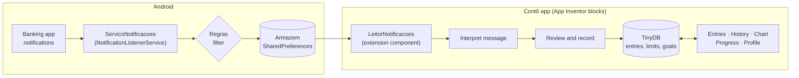

- **App**: a single screen (`Screen1`) built with blocks, with the Entries, History, Chart and Progress tabs and the Profile. Data is stored in the device's TinyDB.
- **Extension** ([`extension/`](extension/)): Java. `ServicoNotificacoes` receives notifications, `Regras` decides what to keep and `Armazem` stores it; the `LeitorNotificacoes` component hands pending notifications to the app.
- **Tools** ([`tools/`](tools/)): Python. They generate the project's screen, blocks and images, simulate the app for testing and check the package.

Source comments and the documentation in `extension/`, `tools/` and `docs/` are in Portuguese.

## Quality and testing

| Check | Scope | Result (v2.0.1) |
|---|---|---|
| Test suite | 60 tests that run the `.aia`'s real blocks in a simulator | 60/60, 110,043 checks |
| App mutation testing | 413 deliberately planted defects, one at a time | 413/413 detected |
| Extension tests (Java) | 45 checks and 21 planted defects in the rules | 45/45 and 21/21 |
| Static checkers | Blocks and screen compared against the official App Inventor source code | 0 errors |
| Text contrast | Every text on the screens, in both themes | Minimum 4.55:1 (WCAG AA) |

The extension tests run on every push in [GitHub Actions](https://github.com/Ruanleal/conto/actions). Methodology, commands and limits are in [`docs/TESTING.md`](docs/TESTING.md) (in Portuguese).

## Repository structure

```
conto/
├── app/            App Inventor project (Conto.aia)
├── extension/      Notification reader extension: Java source, tests and build
├── tools/          Generators, simulator, test suite and checkers (Python)
├── docs/           Testing guide, screenshots and images
├── examples/       Fictitious bank statements for testing the import
├── CHANGELOG.md    Version history (in Portuguese)
└── LICENSE
```

## Known limitations

- **Android shows the version as 1.0.** The 2.0.1 number is set in the project settings, but App Inventor uses the value from Screen1, which is missing. This does not affect how the app works and will be fixed in the next version.
- On some phones the layout is taller than in the simulator screens, because background images set a minimum height.
- The app is not on the Play Store: it is installed from the APK built in App Inventor.

See the [CHANGELOG](CHANGELOG.md) for the full version history.

## License

Released under the MIT License. See [LICENSE](LICENSE). The Manrope fonts included in the project are distributed under the SIL Open Font License 1.1.

---

<div align="center">
Made by <a href="https://github.com/Ruanleal">@Ruanleal</a>
</div>
