<div align="center">


# Contô

**Controle financeiro pessoal para Android, feito no MIT App Inventor.**

[](https://github.com/Ruanleal/conto/actions/workflows/ci.yml)
[](https://github.com/Ruanleal/conto/releases/latest)
[](LICENSE)
[](#instalação)
[](https://appinventor.mit.edu)

**Português** · [English](README.en.md)

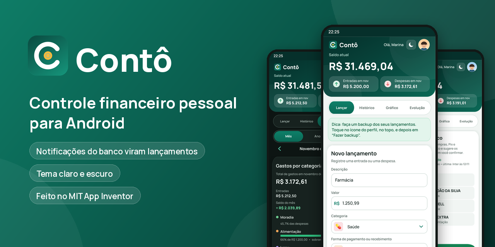

</div>

## Sumário

- [Sobre](#sobre)
- [Funcionalidades](#funcionalidades)
- [Capturas de tela](#capturas-de-tela)
- [Instalação](#instalação)
- [Leitor de notificações do banco](#leitor-de-notificações-do-banco)
- [Atualizar sem perder os dados](#atualizar-sem-perder-os-dados)
- [Arquitetura](#arquitetura)
- [Qualidade e testes](#qualidade-e-testes)
- [Estrutura do repositório](#estrutura-do-repositório)
- [Limitações conhecidas](#limitações-conhecidas)
- [Licença](#licença)

## Sobre

O Contô é um app de finanças pessoais para saber para onde vai o dinheiro sem planilhas complicadas. Você lança entradas e despesas em poucos toques, acompanha os gastos do mês por categoria e vê a evolução ao longo do tempo. Desde a versão 2.0, o app também lê as notificações dos apps de banco e sugere os lançamentos para você conferir.

Tudo fica no próprio celular: não há conta, login nem envio de dados para a internet.

## Funcionalidades

| | |
|---|---|
| **Lançamentos** | Entradas e despesas com valor em reais (vírgula e centavos), categoria e forma de pagamento com ícones, data (inclusive dias passados) e opção de repetir todo mês. |
| **Histórico** | Mês, ano ou todo o período; busca que ignora maiúsculas e acentos; editar e excluir, sempre com confirmação. |
| **Gráfico** | Rosca de gastos por categoria, com o total do período, as entradas, o saldo e os limites de cada categoria. |
| **Limites** | Um limite mensal por categoria, com aviso ao lançar quando o gasto chega perto ou passa do limite. |
| **Evolução** | Entradas e despesas mês a mês, resumo do mês escolhido e meta de economia com previsão de quando ela será alcançada. |
| **Notificações do banco** | Lê as notificações dos apps de banco e sugere lançamentos. Também dá para colar a mensagem ou o SMS do banco. |
| **Importar extrato** | Lê o extrato do banco em CSV, em vários formatos de data e valor, sugere a categoria e não duplica o que já existe. |
| **Seus dados** | Exportar planilha, fazer e restaurar backup, com lembrete de backup. |
| **Perfil e tema** | Nome e foto (câmera ou galeria) e tema claro ou escuro. |

## Capturas de tela

| Lançar | Histórico | Gráfico | Evolução |
|:---:|:---:|:---:|:---:|
| 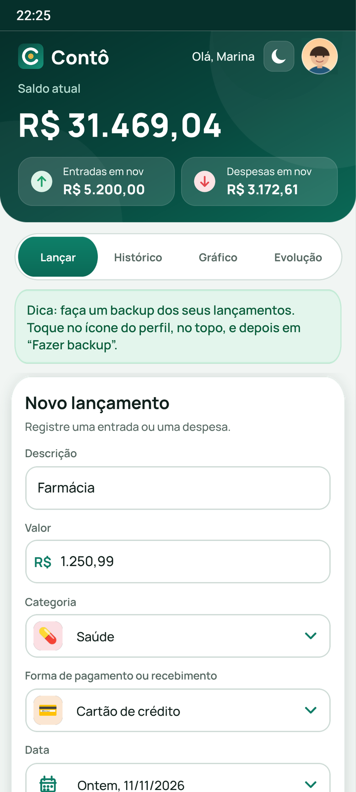 | 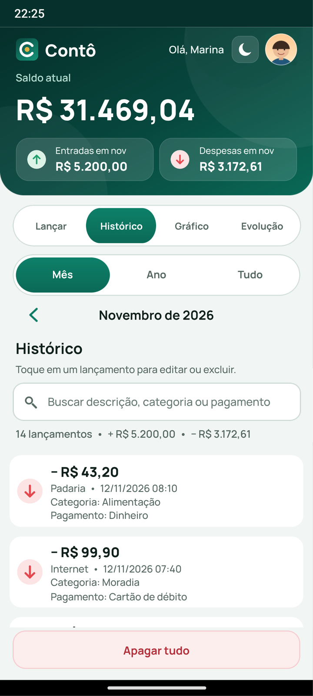 | 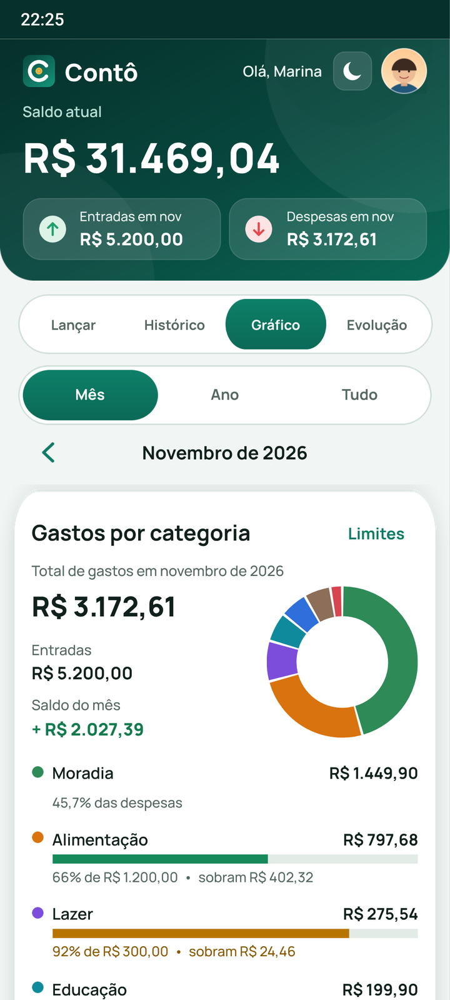 | 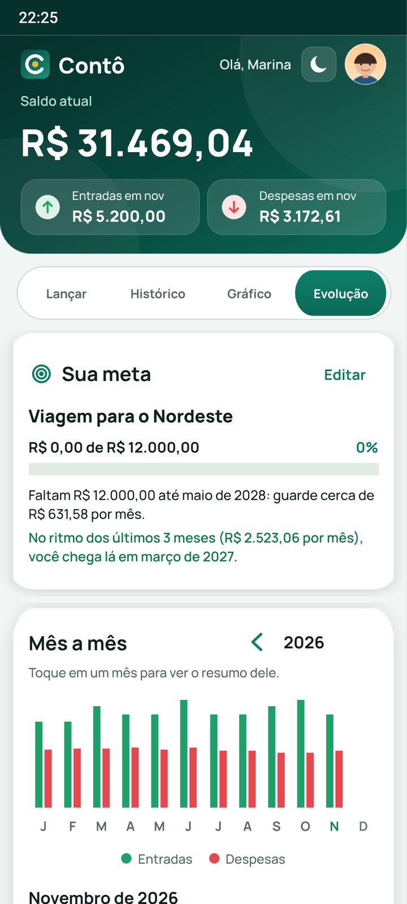 |

| Notificações do banco | Mensagem colada | Limites | Perfil |
|:---:|:---:|:---:|:---:|
| 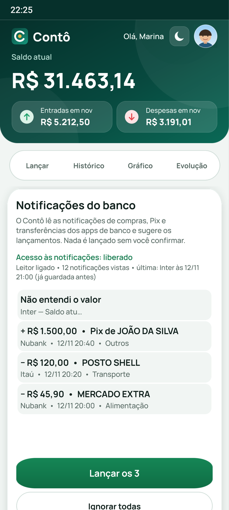 | 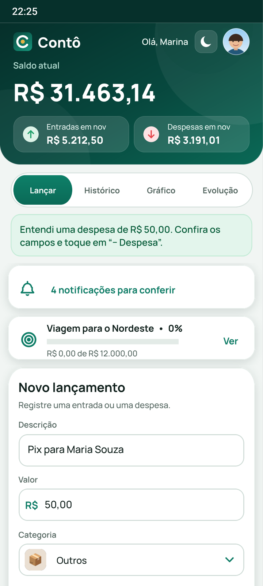 | 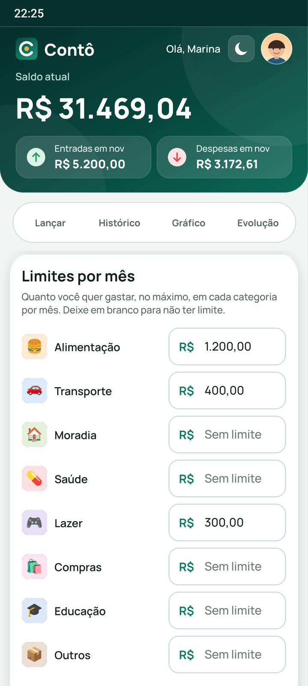 | 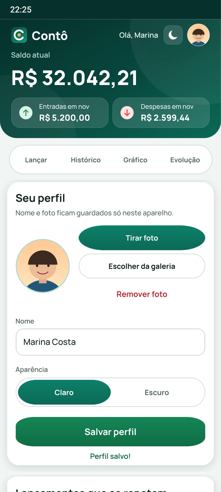 |

<details>
<summary><b>Tema escuro</b></summary>
<br>

| Lançar | Histórico | Gráfico | Notificações do banco |
|:---:|:---:|:---:|:---:|
| 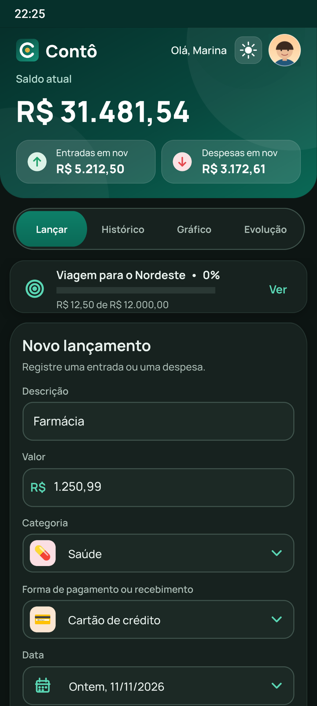 | 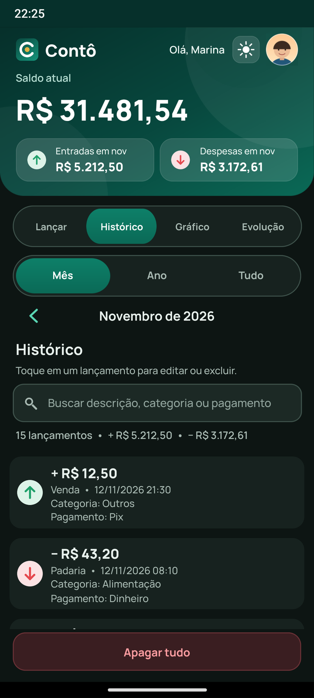 | 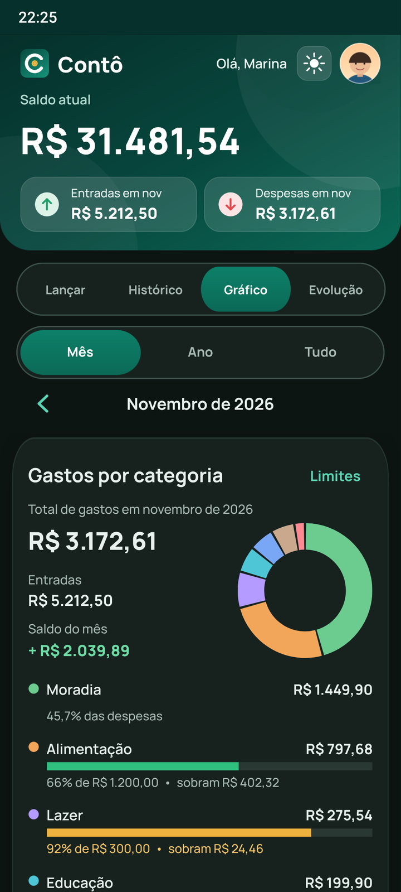 | 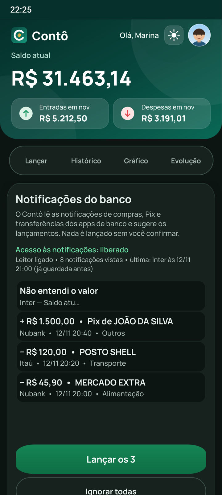 |

</details>

As telas foram desenhadas pelo simulador do projeto a partir do `.aia`, com dados de exemplo.

## Instalação

Você precisa de uma conta gratuita no [MIT App Inventor](https://ai2.appinventor.mit.edu) e de um celular Android.

1. Baixe o `Conto.aia` na [versão mais recente](https://github.com/Ruanleal/conto/releases/latest) (ou na pasta [`app/`](app/)).
2. No App Inventor, abra **Projetos → Importar projeto (.aia) do meu computador** e escolha o arquivo. A extensão de notificações já vem dentro do projeto.
3. Use **Compilar → Android App (.apk)** e instale o APK no celular.

> [!IMPORTANT]
> Instale pelo APK. O AI Companion não tem o serviço que recebe as notificações, então o leitor só funciona no app instalado.

## Leitor de notificações do banco

O App Inventor não tem um bloco para ler notificações de outros apps, então o Contô usa uma extensão própria, [`com.conto.notificacoes`](extension/):

- um serviço do Android guarda as notificações dos apps de banco, mesmo com o Contô fechado;
- o app interpreta cada uma (entrada ou despesa, valor e descrição) e mostra uma lista para conferir: nada é lançado sem a sua confirmação;
- por padrão, só guarda notificações com valor em R$ e ignora apps de conversa, e-mail e redes sociais;
- as notificações ficam só no celular.

**Liberar o acesso.** No app, abra **Perfil → Seus dados → Notificações do banco** e toque em **Liberar acesso**. No Android 13 ou mais novo, um app instalado por APK pode aparecer como **"Configuração restrita"**. Nesse caso:

1. Abra **Configurações → Apps → Contô**.
2. Toque no menu **⋮** e em **Permitir configurações restritas**. A opção só aparece depois da primeira tentativa de liberar o acesso.
3. Volte ao Contô e libere o acesso de novo.

Em celulares Xiaomi e Redmi, ligue também o **Início automático** do Contô e tire a economia de bateria dele, para o sistema não desligar o leitor.

## Atualizar sem perder os dados

1. No app instalado, faça um backup em **Perfil → Seus dados → Fazer backup**.
2. Importe o `.aia` novo no App Inventor com **o mesmo nome do projeto** que gerou o app instalado. O nome do projeto define o pacote do app; com outro nome, o Android instala um segundo app, e aí basta usar **Perfil → Seus dados → Restaurar backup** nele.
3. Compile o APK e instale por cima. Não use o Companion para isso.

## Arquitetura

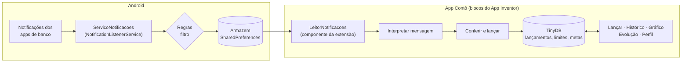

- **App**: uma tela (`Screen1`) feita em blocos, com as abas Lançar, Histórico, Gráfico e Evolução e o Perfil. Os dados ficam no TinyDB do aparelho.
- **Extensão** ([`extension/`](extension/)): em Java. `ServicoNotificacoes` recebe as notificações, `Regras` decide o que guardar e `Armazem` guarda; o componente `LeitorNotificacoes` entrega as pendentes ao app.
- **Ferramentas** ([`tools/`](tools/)): em Python. Geram a tela, os blocos e as imagens do projeto, simulam o app para testar e verificam o pacote.

## Qualidade e testes

| Verificação | Escopo | Resultado (v2.0.1) |
|---|---|---|
| Bateria de testes | 60 testes que executam os blocos reais do `.aia` num simulador | 60/60, 110.043 verificações |
| Teste de mutação do app | 413 defeitos plantados de propósito, um por vez | 413/413 detectados |
| Testes da extensão (Java) | 45 verificações e 21 defeitos plantados nas regras | 45/45 e 21/21 |
| Verificadores estáticos | Blocos e tela comparados com o código-fonte oficial do App Inventor | 0 erros |
| Contraste dos textos | Todos os textos das telas, nos dois temas | Mínimo de 4,55:1 (WCAG AA) |

Os testes da extensão rodam a cada push no [GitHub Actions](https://github.com/Ruanleal/conto/actions). Metodologia, comandos e limites estão em [`docs/TESTING.md`](docs/TESTING.md).

## Estrutura do repositório

```
conto/
├── app/            Projeto do App Inventor (Conto.aia)
├── extension/      Extensão Leitor de notificações: código Java, testes e compilação
├── tools/          Geradores, simulador, bateria de testes e verificadores (Python)
├── docs/           Guia de testes, capturas de tela e imagens
├── examples/       Extratos de banco fictícios para testar a importação
├── CHANGELOG.md    Histórico de versões
└── LICENSE
```

## Limitações conhecidas

- **A versão aparece como 1.0 no Android.** O número 2.0.1 está nas configurações do projeto, mas o App Inventor usa o valor do Screen1, que ficou sem esse campo. Não afeta o funcionamento e será corrigido na próxima versão.
- Em alguns celulares o layout fica mais alto do que nas telas do simulador, porque as imagens de fundo definem uma altura mínima.
- O app não está na Play Store: a instalação é pelo APK gerado no App Inventor.

O histórico completo de mudanças está no [CHANGELOG](CHANGELOG.md).

## Licença

Distribuído sob a licença MIT. Veja [LICENSE](LICENSE). As fontes Manrope incluídas no projeto são distribuídas sob a SIL Open Font License 1.1.

---

<div align="center">
Feito por <a href="https://github.com/Ruanleal">@Ruanleal</a>
</div>
